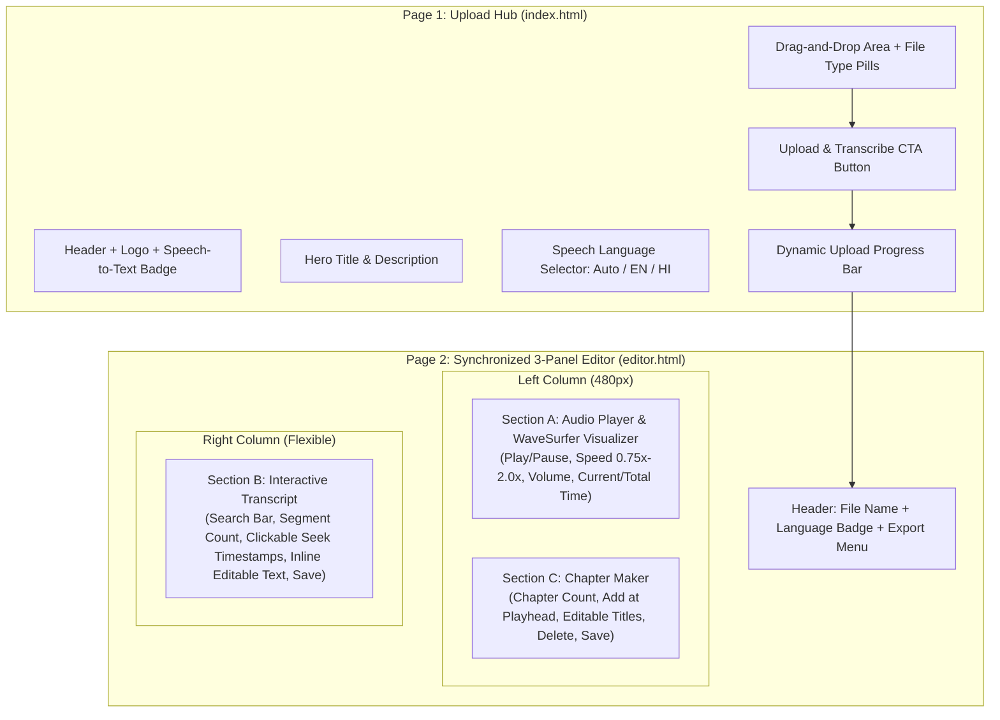
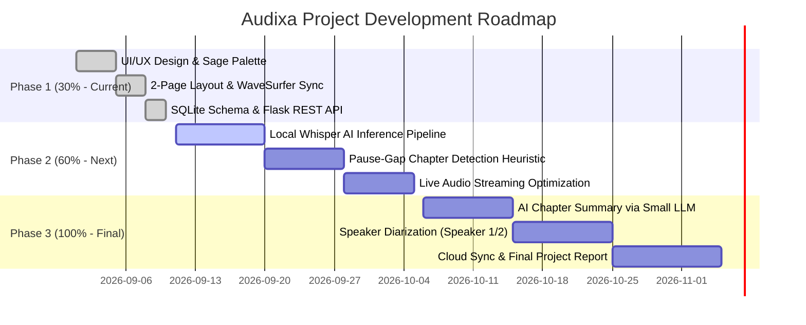

# 🎙️ Audixa — Project Implementation Plan & 30% Milestone Blueprint

> **Project Name:** **Audixa** (Audio Transcript & Chapter Maker)  
> **Project Type:** Web Application (Speech Processing, Audio Synchronization & Content Structuring)  
> **Current Milestone:** **Phase 1 Monitoring (30% Completed)**  
> **Target Review Focus:** Frontend Architecture, UI/UX Interaction Design, Audio Engine Integration, Database Modeling, and API Contract Design.

---

## 📌 1. Project Overview & Problem Statement

### 🎯 Problem:
Creators, students, researchers, and podcast producers spend hours manually listening to lengthy recordings (lectures, meetings, interviews, YouTube videos) to write down timestamped notes, transcribe dialogue, and create video navigation chapters.

### 💡 Solution (Audixa):
Audixa is a dedicated, distraction-free 2-page web platform that provides:
1. **Audio/Video Ingestion:** Direct file uploading supporting all major audio and video media formats.
2. **Synchronized Playback:** Interactive audio waveform visualizer powered by `wavesurfer.js`.
3. **Simultaneous 3-Panel Editor:** A unified screen that places the **Audio Player**, **Interactive Transcript**, and **Chapter Maker** side-by-side with real-time timestamp highlighting.
4. **Bilingual Speech Readiness:** Architectural support for English, Hindi, and code-switched Hinglish audio.
5. **Multi-Format Exporting:** Instant generation of `.txt`, `.srt`, `.vtt`, YouTube Timestamp chapters, and `.json` data.

---

## 🎨 2. Visual Identity & Design System

The application uses a **Warm Organic Sage & Cream Light Design System** (flat, high-contrast, zero-glassmorphism) optimized for clarity and academic presentation:

```
┌────────────────────────────────────────────────────────────────────────┐
│  #F8F6EB (Warm Cream / Linen) ─ Main App Background & Card Backing      │
├────────────────────────────────────────────────────────────────────────┤
│  #C6D99E (Soft Sage Mint)     ─ Badges, Waveform Idle Bars & Accents   │
├────────────────────────────────────────────────────────────────────────┤
│  #758359 (Muted Olive Leaf)   ─ Primary Action Buttons & Active State  │
├────────────────────────────────────────────────────────────────────────┤
│  #242D1C (Deep Forest Moss)   ─ High-Contrast Body Text & Headings     │
└────────────────────────────────────────────────────────────────────────┘
```

---

## 💻 3. Programming Languages & Technical Stack

### A. Languages Used in the Codebase

| Language | Role in Audixa | Key Files |
| :--- | :--- | :--- |
| **HTML5** | Semantic structure for 2 core views (Upload Hub and 3-Panel Editor). | [`templates/index.html`](file:///C:/Users/Daksh%20Rajput/.gemini/antigravity-ide/scratch/Audixa/templates/index.html), [`templates/editor.html`](file:///C:/Users/Daksh%20Rajput/.gemini/antigravity-ide/scratch/Audixa/templates/editor.html) |
| **CSS3 (Vanilla)** | Custom flat design system, color variables, layout grids, and responsive containers. | [`static/css/styles.css`](file:///C:/Users/Daksh%20Rajput/.gemini/antigravity-ide/scratch/Audixa/static/css/styles.css) |
| **JavaScript (ES6+)** | Dynamic UI logic, WaveSurfer waveform initialization, timestamp seeking, inline text editing, and file export triggers. | [`static/js/upload.js`](file:///C:/Users/Daksh%20Rajput/.gemini/antigravity-ide/scratch/Audixa/static/js/upload.js), [`static/js/editor.js`](file:///C:/Users/Daksh%20Rajput/.gemini/antigravity-ide/scratch/Audixa/static/js/editor.js) |
| **Python 3** | Backend web server, file system I/O, REST endpoints, and audio byte-range streaming. | [`app.py`](file:///C:/Users/Daksh%20Rajput/.gemini/antigravity-ide/scratch/Audixa/app.py), [`db.py`](file:///C:/Users/Daksh%20Rajput/.gemini/antigravity-ide/scratch/Audixa/db.py), [`transcriber.py`](file:///C:/Users/Daksh%20Rajput/.gemini/antigravity-ide/scratch/Audixa/transcriber.py) |
| **SQL (SQLite)** | Relational database schema creation, table relationships, foreign keys, and CRUD operations. | Embedded in [`db.py`](file:///C:/Users/Daksh%20Rajput/.gemini/antigravity-ide/scratch/Audixa/db.py) |

### B. Frameworks & External Libraries
- **Backend Framework:** Python Flask (`Flask 3.1.0`)
- **Audio Waveform Visualization:** `WaveSurfer.js v7` (via CDN)
- **Database Engine:** SQLite3 (Python standard library `sqlite3`, local file `audixa.db`)
- **Planned AI Model (Phase 2):** `faster-whisper` / OpenAI Whisper (CTranslate2 `int8` CPU engine)

---

## 🖥️ 4. Current Website Content & Structure (What Is Built)



### 1. Page 1: Upload Hub ([`index.html`](file:///C:/Users/Daksh%20Rajput/.gemini/antigravity-ide/scratch/Audixa/templates/index.html))
- **Branded Navigation:** Clean logo and "Speech to Text" badge.
- **Drag-and-Drop Zone:** Intuitive file picker with visual hover state and format badges (`MP3`, `WAV`, `M4A`, `MP4`, `FLAC`).
- **File Preview:** Displays selected filename and formatted size with a "Change File" button.
- **Language Selector:** Custom `<select>` dropdown (`Auto-detect Hinglish`, `English`, `Hindi`).
- **Progress Feedback:** Integrated progress bar and processing spinner state.

### 2. Page 2: Synchronized 3-Panel Editor ([`editor.html`](file:///C:/Users/Daksh%20Rajput/.gemini/antigravity-ide/scratch/Audixa/templates/editor.html))
- **Section A (Audio Player & Waveform):**
  - Interactive canvas waveform powered by WaveSurfer.js.
  - Controls: Play/Pause button, Playback Speed selector (`0.75x`, `1.0x`, `1.25x`, `1.5x`, `2.0x`), Volume slider, and real-time MM:SS timer (`00:00 / 00:00`).
- **Section B (Interactive Transcript):**
  - Instant search bar to filter spoken phrases in real time.
  - Card-based transcript segments showing start/end timestamps.
  - **Live Playback Sync:** Highlights the active spoken segment and auto-scrolls to keep it in view.
  - **Click-to-Seek:** Clicking any timestamp seeks audio immediately to that exact moment.
  - **Inline Editing:** Segments are content-editable for quick typo corrections.
- **Section C (Chapter Maker):**
  - Chapter counter badge and timestamp markers.
  - "+ Add at Current Time" button to create chapters at the active audio playhead.
  - Editable chapter title inputs and single-click delete buttons.
- **Export Engine:**
  - One-click export to **Plain Text (`.txt`)**, **SubRip Subtitles (`.srt`)**, **WebVTT (`.vtt`)**, **YouTube Timestamps**, and **Structured Metadata (`.json`)**.

---

## 🗄️ 5. Database Architecture (SQLite Schema)

```sql
-- 1. Master Audio Transcripts
CREATE TABLE IF NOT EXISTS transcripts (
    id TEXT PRIMARY KEY,
    filename TEXT NOT NULL,
    original_name TEXT NOT NULL,
    language_mode TEXT DEFAULT 'auto',
    detected_language TEXT,
    duration REAL DEFAULT 0.0,
    model_size TEXT DEFAULT 'base',
    created_at TIMESTAMP DEFAULT CURRENT_TIMESTAMP
);

-- 2. Timestamped Dialogue Segments
CREATE TABLE IF NOT EXISTS segments (
    id INTEGER PRIMARY KEY AUTOINCREMENT,
    transcript_id TEXT NOT NULL,
    segment_index INTEGER NOT NULL,
    start_time REAL NOT NULL,
    end_time REAL NOT NULL,
    text TEXT NOT NULL,
    FOREIGN KEY (transcript_id) REFERENCES transcripts(id) ON DELETE CASCADE
);

-- 3. Video / Podcast Chapter Markers
CREATE TABLE IF NOT EXISTS chapters (
    id INTEGER PRIMARY KEY AUTOINCREMENT,
    transcript_id TEXT NOT NULL,
    chapter_index INTEGER NOT NULL,
    start_time REAL NOT NULL,
    end_time REAL NOT NULL,
    title TEXT NOT NULL,
    FOREIGN KEY (transcript_id) REFERENCES transcripts(id) ON DELETE CASCADE
);
```

---

## 📈 6. Three-Phase Project Roadmap



---

## 🎤 7. Viva & Project Monitoring Presentation Cheatsheet

### 💬 How to present your 30% milestone:
> *"Respected evaluators, for our **Phase 1 (30% Monitoring)**, we have successfully developed the complete **Frontend User Interface, Audio Player Engine, and Database Architecture** for Audixa.*  
> *We have established the 2-page interface consisting of an intuitive Upload Hub and a synchronized 3-Panel Editor. The interface connects to our Flask backend and SQLite database to manage audio metadata, transcript segments, and chapter points with full click-to-seek waveform interaction and multi-format export capabilities. In the next phase (60%), we will connect the live Whisper AI speech-to-text inference pipeline."*

### ❓ Key Expected Questions & Answers:

**Q1: What is completed in this 30% stage?**  
**A:** The entire frontend design system, audio ingestion workflow, WaveSurfer waveform player, interactive 3-panel synchronized editor, SQLite database schema with foreign keys, and REST API routes for saving and exporting transcripts.

**Q2: Which programming languages and tools are used?**  
**A:** Python 3 (Flask backend), HTML5 (semantic layouts), CSS3 (custom flat sage & cream design system), Vanilla JavaScript ES6+ (interactivity & WaveSurfer sync), and SQL (SQLite3 database).

**Q3: Why is a simultaneous 3-panel editor better than tabbed views?**  
**A:** Tabbed views force users to constantly switch contexts between listening, editing text, and marking chapters. The 3-panel layout displays the Audio Player, Transcript, and Chapters simultaneously, allowing seamless cross-synchronization and instant playback seeking.

**Q4: What is planned for the next 60% review?**  
**A:** Hooking up local `faster-whisper` AI speech-to-text inference to transcribe English, Hindi, and mixed Hinglish audio, alongside automated silence pause-gap chaptering.
