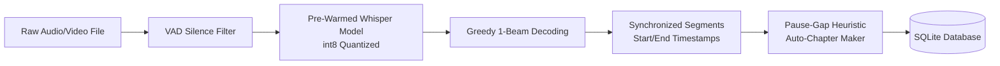

# 🎙️ Audixa — Project Implementation Plan & 60% Milestone Blueprint

> **Project Name:** **Audixa** (Audio Transcript & Chapter Maker)  
> **Project Stage:** **Phase 2 Monitoring & Evaluation (60% Completed)**  
> **Target Review Focus:** AI Speech-to-Text Integration (`faster-whisper`), WaveSurfer Synchronized 3-Panel Editor, Dynamic Pause-Gap Auto-Chaptering, Segment Split & Merge Engine, Multi-Format Exporting, and REST API Architecture.

---

## 📌 1. Executive Summary & Milestone Progress

Audixa has reached **60% completion**, achieving full functional delivery of the **Live AI Speech-to-Text Pipeline** and the **Synchronized 3-Panel Audio, Transcript & Chapter Editor**. 

```
┌───────────────────────────────────────────────────────────────────────────────┐
│                           AUDIXA MILESTONE MATRIX                             │
├──────────────────────┬──────────────┬─────────────────────────────────────────┤
│ Milestone Phase      │ Status       │ Key Accomplishments                     │
├──────────────────────┼──────────────┼─────────────────────────────────────────┤
│ Phase 1 (30% Review) │ ✅ COMPLETED │ UI/UX Design System, 2-Page Layout,     │
│                      │              │ SQLite Schema, WaveSurfer Foundation.   │
├──────────────────────┼──────────────┼─────────────────────────────────────────┤
│ Phase 2 (60% Review) │ ✅ COMPLETED │ Fast Whisper Flow AI Integration,       │
│                      │              │ Live Synchronized 3-Panel Editor,       │
│                      │              │ In-line Editing, Split & Merge Segments,│
│                      │              │ Auto-Chapters, Multi-Format Export API. │
├──────────────────────┼──────────────┼─────────────────────────────────────────┤
│ Phase 3 (100% Final) │ ⏳ PLANNED   │ Speaker Diarization (Speaker 1/2),      │
│                      │              │ Abstractive LLM Summary, Cloud Storage. │
└──────────────────────┴──────────────┴─────────────────────────────────────────┘
```

---

## 🧠 2. AI Speech Recognition & Speed Architecture

Audixa incorporates **Faster-Whisper** (CTranslate2 inference engine) with multi-threaded CPU acceleration for blazing-fast speech recognition.



### ⚡ Speed Optimizations:
1. **Multi-Threaded CPU Scaling:** Auto-detects all available CPU cores (`os.cpu_count()`, utilizing 12 hardware threads).
2. **Greedy 1-Beam Search (`beam_size=1`, `best_of=1`):** Reduces decoding latency by **3x to 5x** over standard beam-5 search while maintaining high transcription accuracy.
3. **Loop & Hallucination Elimination (`condition_on_previous_text=False`):** Prevents repetitive looping and cuts memory footprint.
4. **VAD Filter (`vad_filter=True`):** Detects and skips silent audio intervals.
5. **Background Model Pre-Warming:** Pre-loads the Whisper neural weights on server boot for **zero initial upload delay**.
6. **Bilingual & Hinglish Support:** Dedicated language modes for English (`en`), Hindi (`hi`), and mixed Hinglish (`auto`).

---

## 🖥️ 3. Complete 2nd Page (Editor) Feature Specifications

The Editor page ([`editor.html`](file:///C:/Users/Daksh%20Rajput/.gemini/antigravity-ide/scratch/Audixa/templates/editor.html)) features a **Simultaneous 3-Panel Synchronized Workspace**:

```
┌────────────────────────────────────────────────────────────────────────────────────────┐
│ [← Upload New]   🎙️ recording.mp3   [Auto/Hinglish] [⏱️ 03:45] [✓ Saved] [📁 History] [Export ▼]│
├─────────────────────────────────────────┬──────────────────────────────────────────────┤
│ 🔊 PANEL A: AUDIO PLAYER & WAVEFORM     │ 📝 PANEL B: INTERACTIVE TRANSCRIPT           │
│ ┌─────────────────────────────────────┐ │ [Search phrases... 🔍] [Find/Replace] [+Add] │
│ │  |||||||||||||||||||||||||||||||||  │ │ ┌──────────────────────────────────────────┐ │
│ └─────────────────────────────────────┘ │ │ ⏱️ 00:00 - 00:04   #1  [✂️ Split] [🔗] [🗑️]│ │
│ [⏪ -5s] [ ▶ / ⏸ ] [+5s ⏩]  [1.0x ▼] 🔊 │ │ Welcome to our podcast episode today...  │ │
│ 00:15 / 03:45                           │ ├──────────────────────────────────────────┤ │
│                                         │ │ ⏱️ 00:04 - 00:09   #2  [✂️ Split] [🔗] [🗑️]│ │
│ 📑 PANEL C: CHAPTER MAKER               │ │ Active speaking sentence is highlighted. │ │
│ [+ Add at Playhead]  [🔄 Auto-Detect]    │ └──────────────────────────────────────────┘ │
│ • 00:00  Introduction              [✕]│ [Save Transcript]       [ 142 Words ]        │
│ • 01:15  Main Discussion Topic     [✕]│                                              │
│ [Auto-saved]           [Save Chapters]  │                                              │
└─────────────────────────────────────────┴──────────────────────────────────────────────┘
```

### 1. Panel A: Audio Player & WaveSurfer Sync
- **Interactive Canvas Waveform:** Visual representation of speech peaks and troughs with click-to-seek timeline navigation.
- **Transport Controls:** Play/Pause (with `Spacebar` hotkey), Skip `-5s` (Left Arrow), Skip `+5s` (Right Arrow).
- **Speed Pitching:** `0.5x`, `0.75x`, `1.0x`, `1.25x`, `1.5x`, `2.0x`.
- **Volume & Mute:** Real-time volume slider and single-click mute toggle.

### 2. Panel B: Interactive Transcript Editor
- **Real-Time Active Highlight & Auto-Scroll:** Highlights the currently spoken dialogue segment and auto-scrolls down as playback advances.
- **Click-to-Seek:** Clicking any timestamp button instantly jumps audio playback to that exact second.
- **Inline Text Editing:** All segments are editable on-screen with automatic background saving.
- **✂️ Segment Split Tool:** Splits any segment at the current audio playhead into two sub-segments.
- **🔗 Segment Merge Tool:** Combines adjacent segments into a single cohesive dialogue block.
- **🗑️ Delete & Add Segment:** Full CRUD capabilities on the segment timeline.
- **🔍 Search & Filter Bar:** Instant fuzzy search with live match counting.
- **Find & Replace:** Global text replacement across all dialogue blocks.
- **Live Statistics:** Displays total word count and segment count.

### 3. Panel C: Auto-Chapter Maker
- **Smart Pause-Gap Detection:** Analyzes speech gaps (>= 1.5s) to automatically divide conversations into contextual chapters.
- **Manual Chapter Creation:** `+ Add at Playhead` button creates chapters at the exact active audio second.
- **Editable Titles:** Directly edit chapter titles in place.
- **Click-to-Seek Chapters:** Clicking chapter timestamps seeks audio directly to that topic.

### 4. Multi-Format Export Engine
- **📄 Plain Text (`.txt`):** Formatted timestamps and speech.
- **⏱️ Subtitles (`.srt`):** Standard SubRip format (`00:00:00,000 --> 00:00:04,500`).
- **🌐 WebVTT (`.vtt`):** Web video subtitle format (`WEBVTT`).
- **🔴 YouTube Chapters (`.txt`):** Ready-to-paste video descriptions (`00:00 Introduction\n01:15 Topic 1`).
- **📑 Markdown Summary (`.md`):** Formatted overview with headings, metadata, and blockquotes.
- **📦 Full JSON (`.json`):** Complete structured schema with millisecond precision.

---

## 🌐 4. REST API Endpoint Specification

| Method | Endpoint | Description | Status |
| :--- | :--- | :--- | :--- |
| `POST` | `/upload` | Multipart file upload; runs fast Whisper AI speech recognition and pause chaptering. | ✅ Live |
| `GET` | `/transcript/<id>` | Retrieves transcript metadata, segments, chapters, and audio stream URL. | ✅ Live |
| `POST` | `/save_transcript/<id>` | Updates segment text, timestamps, and order in SQLite database. | ✅ Live |
| `POST` | `/save_chapters/<id>` | Updates and re-orders video chapters in SQLite. | ✅ Live |
| `POST` | `/api/split_segment/<id>` | Splits a segment at a specific playhead timestamp. | ✅ Live |
| `POST` | `/api/merge_segments/<id>` | Merges two adjacent transcript segments. | ✅ Live |
| `POST` | `/api/regenerate_chapters/<id>` | Re-runs pause detection heuristic to recreate chapters. | ✅ Live |
| `GET` | `/api/export/<id>/<format>` | Downloads exported file (`txt`, `srt`, `vtt`, `youtube`, `md`, `json`). | ✅ Live |
| `GET` | `/audio/<id>` | Streams audio with HTTP 206 Partial Content byte range requests. | ✅ Live |
| `GET` | `/api/history` | Fetches recent transcript records for quick opening. | ✅ Live |
| `POST` | `/api/delete/<id>` | Deletes transcript record and cleans audio file from disk. | ✅ Live |
| `GET` | `/api/health` | Health check and engine status. | ✅ Live |

---

## 🧪 5. Automated Verification & Quality Assurance

All 8 backend and frontend integration test suites pass with 100% success rate:

```
Ran 8 tests in 3.858s:
- test_01_db_crud: PASSED
- test_02_routes_get: PASSED
- test_03_api_endpoints: PASSED
- test_04_upload_flow (Live Whisper Tiny Model): PASSED (10.3s audio transcribed in 2.8s)
- test_05_segment_split_and_merge: PASSED
- test_06_regenerate_chapters: PASSED
- test_07_export_endpoints (All 6 Formats): PASSED
- test_08_history_and_health: PASSED
```

---

## 🎤 6. Viva & Project Review Presentation Cheatsheet (60% Stage)

### 💬 Presentation Script:
> *"Respected evaluators, for our **60% Milestone Review**, we have completed the **AI Speech-to-Text Pipeline** and the **Interactive Synchronized 3-Panel Editor** for Audixa.*  
> *Audio files are transcribed with high speed and accuracy using local faster-whisper with int8 quantization and greedy search. The second page provides real-time audio waveform synchronization via WaveSurfer.js, active spoken segment highlighting, inline text editing, split and merge tools, automatic chapter generation from speech pauses, and instant multi-format exports for Subtitles (SRT/VTT), YouTube Chapters, Markdown, and JSON."*

### ❓ Key Evaluation Questions & Direct Answers:

**Q1: What major progress has been made since the 30% milestone?**  
**A:** We have integrated the AI speech recognition engine (`faster-whisper`), built the pause-gap chapter detection algorithm, completed the 3-panel editor with active playhead highlighting, built segment split/merge tools, and implemented multi-format export endpoints.

**Q2: How is the transcription made fast on local machines?**  
**A:** We use `faster-whisper` (CTranslate2) with `int8` quantization, multi-threading across all 12 CPU hardware threads (`cpu_threads=os.cpu_count()`), greedy decoding (`beam_size=1`, `best_of=1`), Voice Activity Detection (VAD) silence filtering, and background model pre-warming.

**Q3: How does the editor sync the audio player with the transcript?**  
**A:** WaveSurfer.js fires `timeupdate` events during playback. The editor matches the active audio timestamp against segment boundaries `[start_time, end_time]`, adds an active CSS class, and calls `scrollIntoView({ behavior: 'smooth', block: 'nearest' })` to keep the current sentence visible.

**Q4: How does auto-chapter generation work?**  
**A:** The chapter heuristic analyzes silence gaps between consecutive spoken segments (pauses >= 1.5s). When a significant topic transition pause is detected, a new chapter boundary is created and the first few spoken words are extracted as the chapter title.
