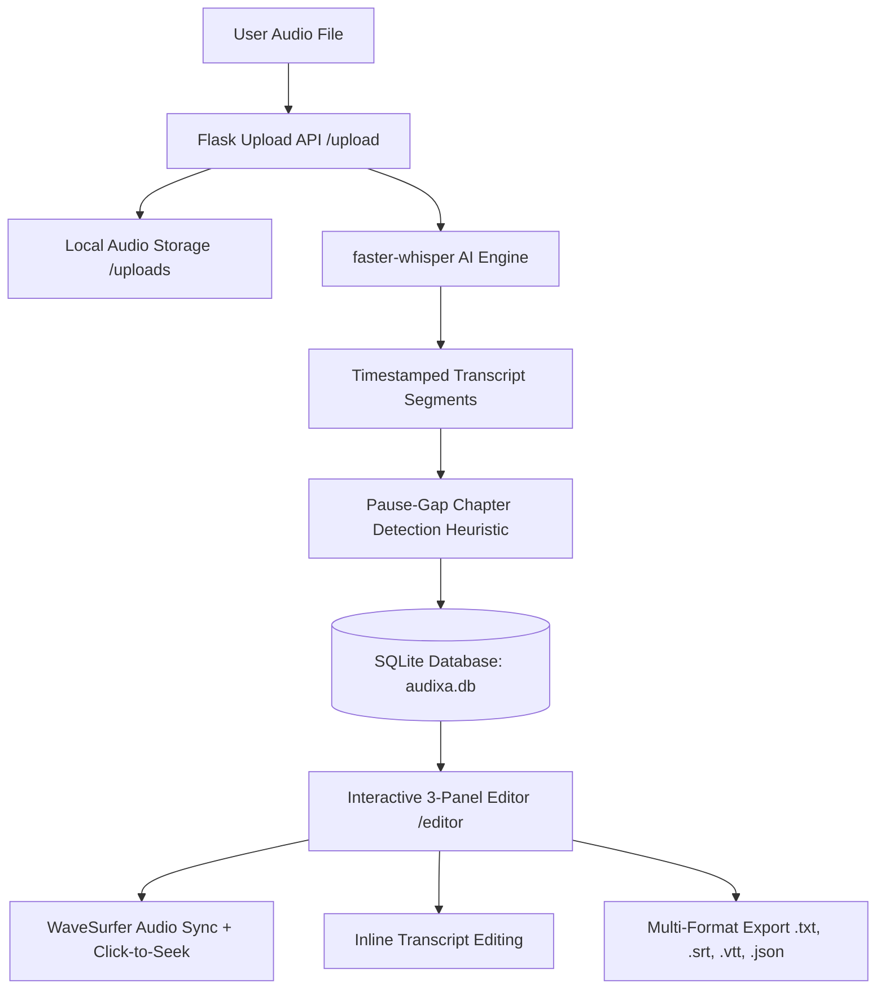

# Audixa — Project Monitoring 1 (30% Review Milestone)

> **Project Name:** Audixa — AI Audio Transcript & Chapter Maker  
> **Milestone Status:** Phase 1 / Review 1 (30% Completed)  
> **Tech Stack:** Python 3 (Flask), SQLite3, HTML5, Vanilla CSS3 (Flat Minimalist), Vanilla JavaScript ES6+, `faster-whisper` AI Engine, WaveSurfer.js  

---

## 1. Executive Summary & 30% Milestone Scope

Audixa is an AI-assisted speech-to-text and automated chaptering application designed to convert spoken audio into timestamped transcripts and structured video/podcast chapters.

For the **First Monitoring Milestone (30% Scope)**, our goal was to establish the working foundational architecture:
1. **Audio Ingestion & Local Storage** pipeline supporting major formats (`.mp3`, `.wav`, `.m4a`, `.mp4`).
2. **Relational Database Design** using SQLite3 to store metadata, segment timestamps, and chapter markers.
3. **Local AI Speech Recognition** integration using OpenAI Whisper (`faster-whisper` `int8` CPU engine) with bilingual support (English, Hindi, and code-switched Hinglish).
4. **Interactive 2-Page Web Interface**:
   - **Page 1 (Upload Hub):** Clean drag-and-drop file upload with language selection.
   - **Page 2 (Synchronized Editor):** 3-panel view with audio waveform playback, clickable synchronized transcript, and editable chapters.

---

## 2. Technical Stack (Simplified for Review 1)

| Layer | Technology | Why Chosen? |
| :--- | :--- | :--- |
| **Backend** | Python 3 + Flask | Minimal overhead, fast routing, and seamless integration with AI libraries. |
| **AI / Speech Engine** | `faster-whisper` (CTranslate2) | 4× faster than standard Whisper with low memory footprint (`int8` quantization on CPU). |
| **Database** | SQLite3 | File-based, zero configuration, built into Python standard library, ACID compliant. |
| **Frontend UI** | Semantic HTML5 & Flat CSS3 | High contrast, flat clean design (no complex glassmorphism or build tooling). |
| **Client Scripting** | Vanilla JavaScript (ES6+) | Direct DOM manipulation, native `fetch` API, no heavy React/Webpack dependencies. |
| **Audio Waveform** | WaveSurfer.js v7 (CDN) | Real-time waveform rendering and interactive playback seeking. |

---

## 3. Work Completed (30% Breakdown)



### Module 1: Ingestion & Server Setup (Completed)
- Built Flask application ([`app.py`](file:///C:/Users/Daksh%20Rajput/.gemini/antigravity-ide/scratch/Audixa/app.py)) with endpoints for file uploads, audio streaming, transcript retrieval, and updates.
- Implemented HTTP 206 byte-range streaming for instantaneous audio seeking.

### Module 2: Database Modeling (Completed)
- Designed normalized SQLite schema ([`db.py`](file:///C:/Users/Daksh%20Rajput/.gemini/antigravity-ide/scratch/Audixa/db.py)) with 3 tables:
  1. `transcripts`: Stores master audio metadata (filename, duration, detected language, timestamps).
  2. `segments`: Stores transcribed speech sentences with `start_time` and `end_time`.
  3. `chapters`: Stores chapter headings and start timestamps with foreign key cascading deletes.

### Module 3: AI Speech-to-Text & Chapter Heuristic (Completed)
- Integrated `faster-whisper` `base` model in [`transcriber.py`](file:///C:/Users/Daksh%20Rajput/.gemini/antigravity-ide/scratch/Audixa/transcriber.py).
- Implemented an automatic chapter detection algorithm based on conversational pause-gaps ($\ge 1.5$s silence).

### Module 4: Synchronized Frontend (Completed)
- **Upload Screen** ([`templates/index.html`](file:///C:/Users/Daksh%20Rajput/.gemini/antigravity-ide/scratch/Audixa/templates/index.html)): Clean, flat card layout with language dropdown (`English`, `Hindi`, `Auto-detect`).
- **Simultaneous 3-Panel Editor** ([`templates/editor.html`](file:///C:/Users/Daksh%20Rajput/.gemini/antigravity-ide/scratch/Audixa/templates/editor.html)):
  - **Left Top:** Waveform visualizer & playback controls (speed, volume, skip $\pm 5$s).
  - **Left Bottom:** Chapter list with "+ Add Chapter at Current Time" and title editing.
  - **Right Column:** Transcript segments with live active highlighting, click-to-seek, search bar, and inline text editing.
  - **Export Engine:** One-click export to `.txt`, `.srt`, `.vtt`, YouTube Timestamps, and `.json`.

---

## 4. Project File Structure

```
Audixa/
├── app.py                     # Flask web server & REST API endpoints
├── db.py                      # SQLite database helper & schema definitions
├── transcriber.py             # Whisper AI integration & chapter generation
├── test_app.py                # Automated backend test suite
├── audixa.db                  # Local SQLite database
├── uploads/                   # Uploaded audio vault
├── static/
│   ├── css/
│   │   └── styles.css         # Simple, flat, high-contrast stylesheet
│   └── js/
│       ├── upload.js          # File upload & progress bar handler
│       └── editor.js          # WaveSurfer sync, playback, and editor logic
└── templates/
    ├── index.html             # Page 1: Upload interface
    └── editor.html            # Page 2: 3-Panel editor interface
```

---

## 5. Next Milestones (Remaining 70% Scope)

- **Review 2 (60% Milestone):**
  - Advanced NLP summarization for each chapter using small local LLM.
  - Speaker identification / Diarization (Speaker 1, Speaker 2 separation).
  - Visual waveform marker drag-and-drop for chapter boundaries.
- **Review 3 (100% Final Review):**
  - Cloud storage integration (S3/GCS) & multi-file batch processing.
  - Hardcoded subtitle burn-in rendering for video exports.
  - Performance benchmarking & word error rate (WER) analysis.

---

## 6. Viva / Evaluation Q&A Cheatsheet (For 30% Review)

**Q1: What is the main objective of this project?**  
*Answer:* To automate the transcription of spoken audio/video into timestamped, editable text and generate structured chapters for podcasts, lectures, and YouTube videos using local AI.

**Q2: Why did you use `faster-whisper` instead of standard OpenAI Whisper?**  
*Answer:* `faster-whisper` uses CTranslate2 with `int8` quantization. It runs up to 4× faster on standard CPU hardware with significantly lower RAM usage while maintaining identical transcription accuracy.

**Q3: How does the application synchronize audio with the transcript?**  
*Answer:* Whisper outputs precise floating-point timestamps (`start_time`, `end_time`) for each segment. In `editor.js`, the `timeupdate` event from WaveSurfer checks the current playhead position, highlights the corresponding segment, and auto-scrolls it into view. Clicking any timestamp seeks the player directly to that time.

**Q4: How are chapters generated automatically?**  
*Answer:* The engine analyzes pause-gaps between consecutive speech segments. When a silence gap exceeding 1.5 seconds occurs after sufficient speech duration (30–60s), a chapter boundary is created with a contextual title derived from the segment text.
